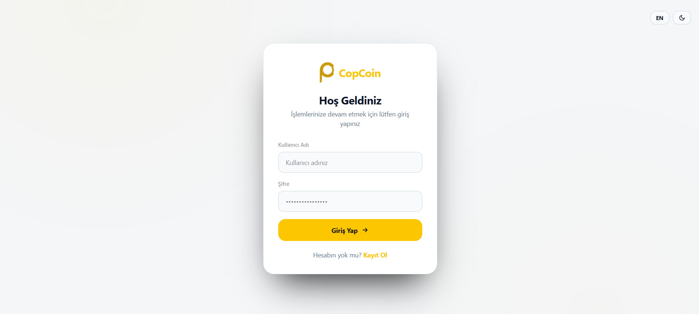
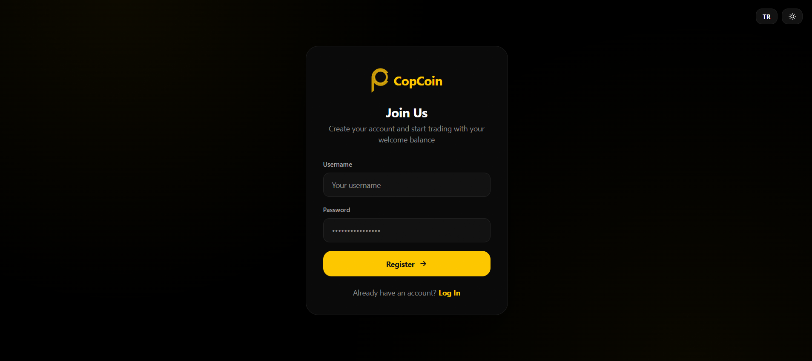
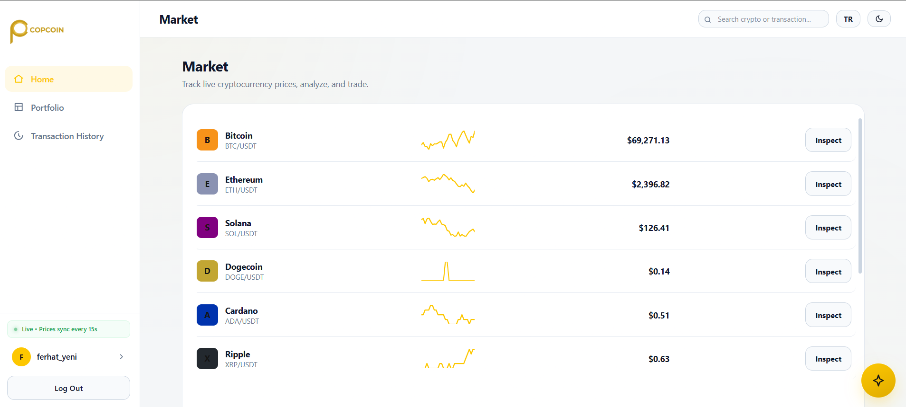
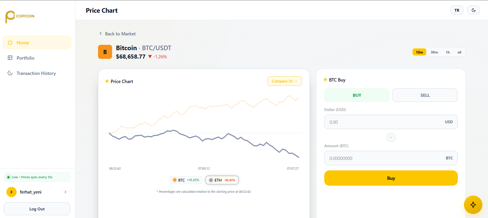
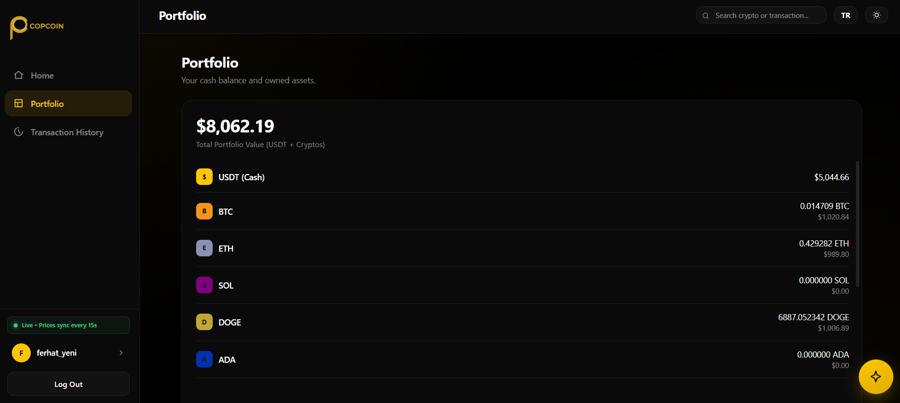
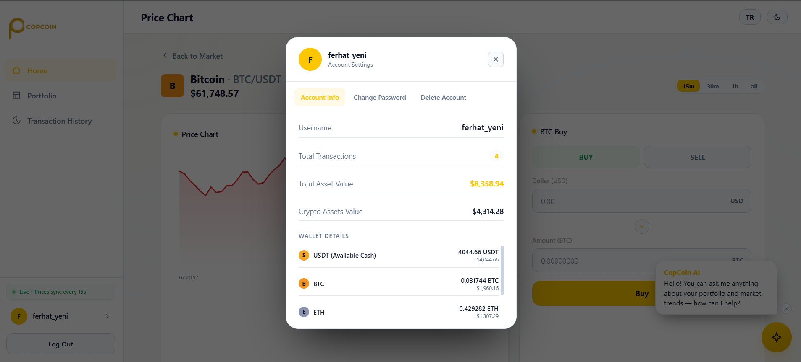
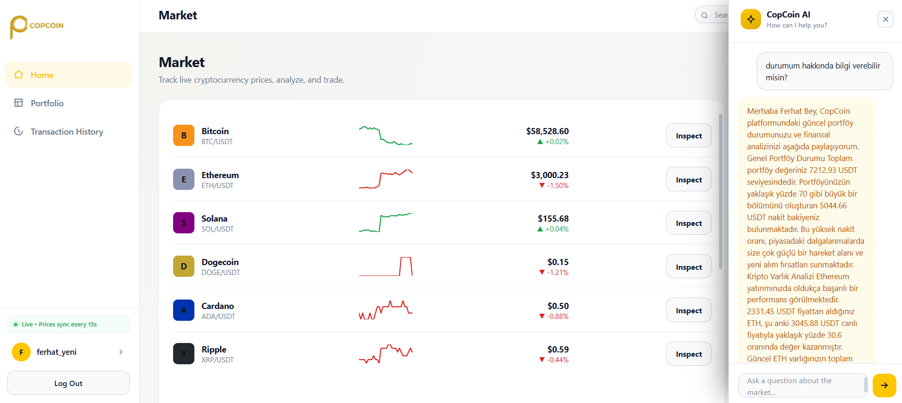
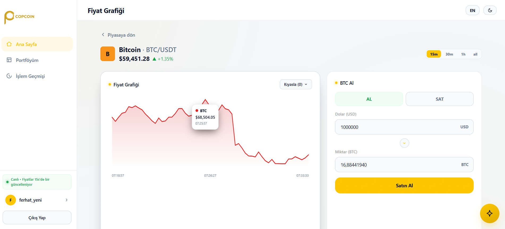

# CopCoin - Real-Time Crypto Trading Simulator with AI Insights

<p align="center">
  
  
  
  
  
  
  
  
</p>

CopCoin is an enterprise-grade full-stack cryptocurrency trading simulation platform. It is engineered with a high-performance **Java 21 / Spring Boot** backend, an ultra-responsive **React SPA** (Single Page Application) frontend, a persistent **PostgreSQL** database, an **Upstash Redis** caching layer, and native **Google Gemini Flash AI** integration.

Designed to replicate professional digital asset trading environments, CopCoin features live-syncing prices (updating every 15 seconds), comprehensive wallet portfolio tracking, multi-asset comparative charts, and an AI-powered financial advisor to guide trades based on user portfolio contexts.

---

## 📸 Screenshots

| 1. Login Authentication | 2. New User Registration |
| --- | --- |
|  |  |

| 3. Live Market Dashboard | 4. Multi-Coin Comparison Chart |
| --- | --- |
|  |  |

| 5. Advanced Portfolio Views | 6. Profile & Security Management |
| --- | --- |
|  |  |

| 7. Draggable Gemini AI Advisor | 8. Trading & Transaction Panel |
| --- | --- |
|  |  |

---

## 💎 Core Features

- **10 Cryptocurrencies Integrated:** Full wallet and market support for **BTC, ETH, SOL, DOGE, ADA, XRP, DOT, AVAX, LINK, and SHIB** with realistic decimal scaling (e.g., 6 decimals for SHIB, 8 for BTC).
- **Interactive Multi-Coin Chart Comparison:** Dynamic client-side normalization that overlays multiple asset curves on a single chart starting from `%0` relative to the first price point of the selected timeframe.
- **Interactive Hover Tooltips:** Real-time canvas tracking that renders HTML tooltips showing exact USD prices, percentage changes, and precise timestamps when hovering over any chart coordinate.
- **Accessible Series Highlighting:** Hovering over legend badges highlights the hovered asset's curve (increases line thickness) while fading out others (`opacity: 0.22`) for visual clarity.
- **Timeframe Filtering:** Seamlessly filter chart timelines across **15m, 30m, 1h, and All** timeframes.
- **Secure HttpOnly Cookie JWT Auth:** Robust JWT authentication using secure `HttpOnly` and `SameSite=Lax` cookie configurations to prevent Cross-Site Scripting (XSS) and Session Hijacking.
- **Gemini Flash AI Investment Assistant:** A draggable chatbot widget that reads current wallet assets and cash balance to provide portfolio evaluations and investment advice.
- **Live Sync Sidebar Status:** A pulsing green active indicator in the sidebar notifying users that the market prices are actively syncing in real-time on a 15-second loop.
- **Modern Dark UI:** Responsive theme with custom-styled rounded, thin webkit scrollbars.

---

## 🏗️ Project Structure

```text
copcoin/
  ├── src/                       # Java 21 Spring Boot Backend Source Code
  │    ├── controller/           # REST APIs (Auth, Wallet, Trade, Price, AI)
  │    ├── service/              # Core Business Logic (Trades, User Management, AI Queries)
  │    ├── repository/           # PostgreSQL Database JPA Repositories
  │    ├── model/                # JPA Database Entities (User, Transaction, PriceTrend)
  │    ├── security/             # Security Interceptors & Session Validators
  │    └── scheduler/            # TickerEngine price simulator (Runs every 15s)
  ├── frontend/                  # React + Vite Single Page Application (SPA)
  │    ├── src/                  # React Components, Views, and CSS Stylesheets
  │    └── public/               # Static Assets (Logos, Icons)
  ├── db-init/                   # Database setup SQL scripts
  ├── Dockerfile                 # Production Multi-stage Docker deployment config
  └── docker-compose.yml         # Local development orchestrator (Postgres & Redis)